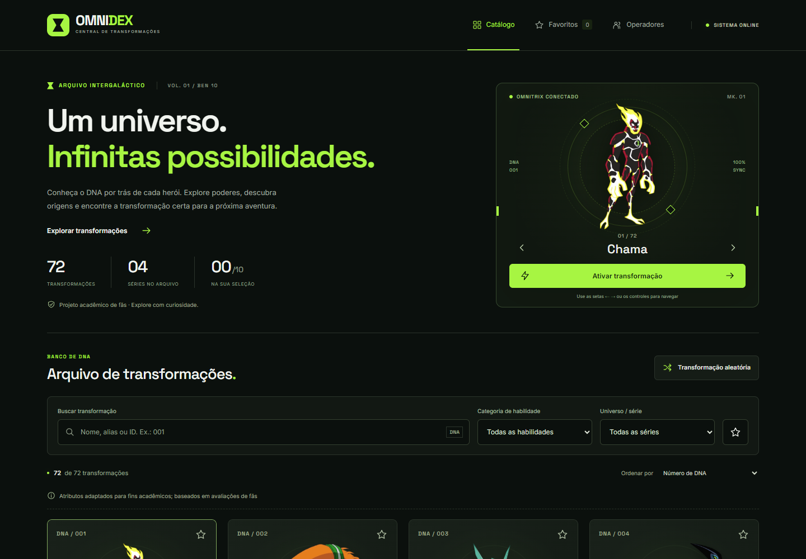
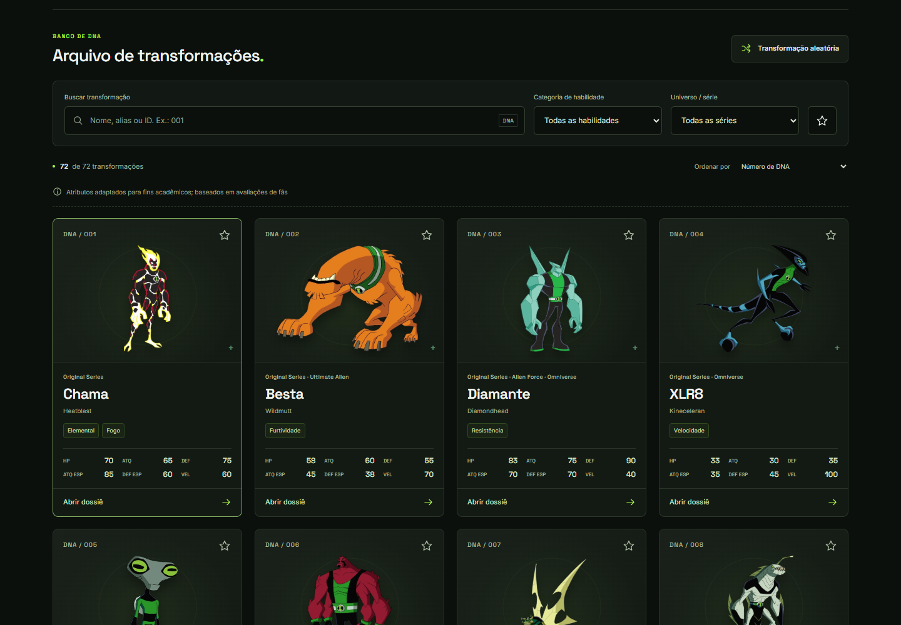
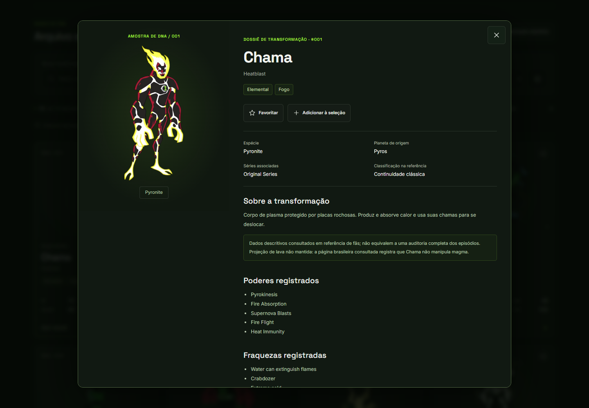
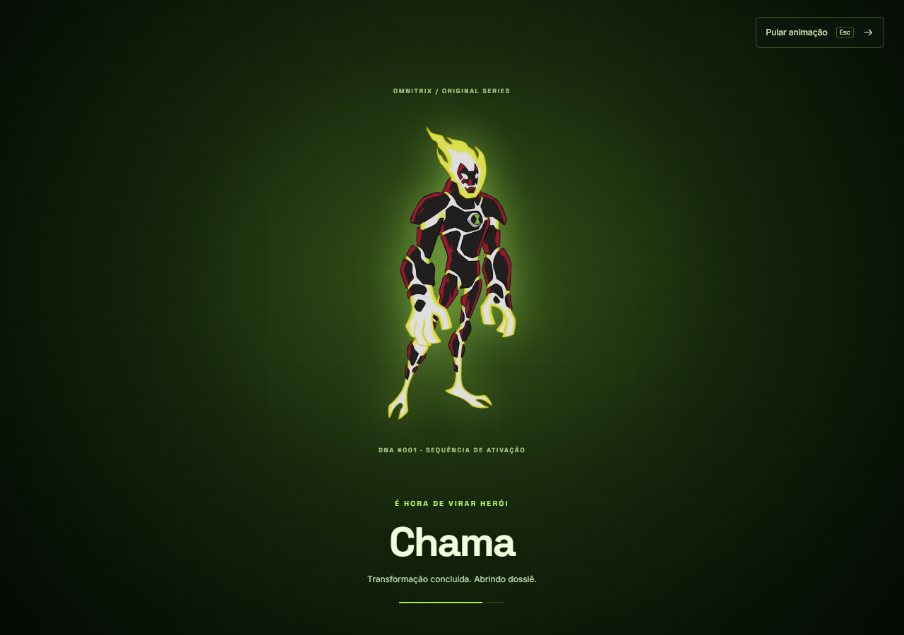
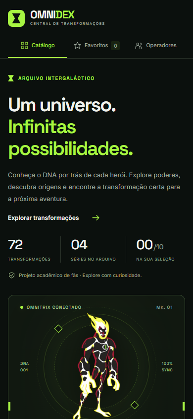

# 🟢 OMNIDEX — Central de Transformações

### Atividade 03 — Pokédex com React + Vite (adaptação temática: Ben 10)

Aplicação web feita com **React + Vite** para exibir, pesquisar, filtrar e explorar um catálogo de criaturas e seus atributos. A dupla manteve todos os requisitos da Pokédex e trocou o tema: no lugar dos Pokémon, o catálogo traz **72 transformações do universo Ben 10**, e no lugar dos treinadores, **operadores do Omnitrix**.



## 👥 Integrantes

| Dupla (Pair Programming)          |
| --------------------------------- |
| Marcelo Gomes de Oliveira Junior  |
| Victor Cândido Leite              |

---

## 📦 Como instalar as dependências

Requisitos: **Node.js 22.12 ou superior** e npm.

```bash
npm install
```

## ▶️ Como executar o projeto

```bash
npm run dev
```

## 🌐 Endereço no navegador

Abra **http://127.0.0.1:5173/** (endereço padrão do Vite). Se a porta 5173 estiver ocupada, o Vite escolhe outra e mostra o endereço correto no terminal, na linha `Local:`.

Para gerar e conferir a versão de produção:

```bash
npm run build
```

```bash
npm run preview
```

O preview costuma abrir em `http://127.0.0.1:4173/`.

## 📁 Onde estão os dados

| O quê                                 | Onde                                   |
| ------------------------------------- | -------------------------------------- |
| Dados completos da aplicação          | **`src/data/pokedex-data.json`**       |
| Índice leve gerado a partir do JSON   | `src/data/catalog-index.json`          |
| Operadores e suas relações            | `src/components/Operators.jsx`         |
| Imagens das transformações (capas)    | `public/images/aliens/`                |
| Imagens das galerias dos dossiês      | `public/images/gallery/`               |
| Metadados das galerias (sob demanda)  | `public/data/galleries/`               |
| Efeitos sonoros                       | `public/audio/`                        |

O nome `pokedex-data.json` foi mantido como pede a atividade; o conteúdo é o equivalente em transformações de Ben 10. Cada registro tem `id`, `name`, `categories` (os “tipos”), `series`, `stats` (os seis atributos), além de espécie, planeta, poderes, fraquezas, descrição, imagem e fontes.

O índice e os arquivos de galeria são gerados automaticamente pelo script `scripts/prepare-runtime-data.mjs`, que roda sozinho antes de `npm run dev` e `npm run build`. **Não há banco de dados, backend nem API**: tudo é local.

## 🧩 Como o projeto está organizado

```text
omnidex/
├── public/
│   ├── images/                 capas e galerias das transformações
│   ├── data/galleries/         JSONs de galeria carregados sob demanda
│   ├── audio/                  efeitos sonoros e manifesto de origem
│   └── licenses/               licenças das fontes tipográficas
│
├── src/
│   ├── components/
│   │   ├── AlienCard.jsx           card: ID, nome, tipos e os seis atributos
│   │   ├── AlienDetails.jsx        detalhes em modal, com radar e galeria
│   │   ├── OmnitrixSelector.jsx    seletor do Omnitrix (anterior/próximo/ativar)
│   │   ├── TransformFlash.jsx      sequência de transformação
│   │   ├── CompareDock.jsx         doca das transformações em comparação
│   │   ├── CompareDialog.jsx       comparação lado a lado
│   │   ├── StatRadar.jsx           radar dos seis atributos (SVG)
│   │   ├── Operators.jsx           operadores (treinadores) e seleção pessoal
│   │   ├── Starfield.jsx           fundo de estrelas em canvas
│   │   └── Icon.jsx                ícones SVG
│   │
│   ├── css/
│   │   ├── base.css                tema, tipografia, cabeçalho e seletor
│   │   ├── catalog.css             pesquisa, filtros e cards
│   │   ├── details.css             detalhes e operadores
│   │   ├── wow.css                 animações, comparação e radar
│   │   ├── omnitrix.css            sequência de transformação
│   │   ├── themes.css              tema claro
│   │   └── comic.css               acabamento de quadrinhos (retícula e contornos)
│   │
│   ├── data/
│   │   ├── pokedex-data.json       dados da aplicação
│   │   └── catalog-index.json      índice gerado
│   │
│   ├── utils/
│   │   ├── catalog.js              pesquisa, filtros, ordenação e fórmulas
│   │   ├── storage.js              favoritos e seleção no localStorage
│   │   ├── sound.js                efeitos sonoros
│   │   └── theme.js                cores por categoria e tema
│   │
│   ├── App.jsx                     estados e composição da aplicação
│   └── main.jsx                    ponto de entrada
│
├── scripts/                        preparo e validação dos dados
├── tests/                          testes unitários e de navegador
├── docs/                           capturas de tela e auditorias
├── package.json
├── vite.config.js
└── README.md
```

Árvore de componentes:

```text
App
 ├── Starfield
 ├── Header (navegação, som e tema)
 ├── OmnitrixSelector
 ├── Pesquisa, filtros e ordenação
 ├── Lista de transformações
 │    ├── AlienCard
 │    ├── AlienCard
 │    └── AlienCard …
 ├── Operators
 ├── CompareDock → CompareDialog
 ├── TransformFlash
 └── AlienDetails → StatRadar
```

---

## 🔁 Da Pokédex para o OMNIDEX

| Pedido na atividade               | No OMNIDEX                                                        |
| --------------------------------- | ----------------------------------------------------------------- |
| Pokémon                           | Transformações (aliens)                                           |
| Tipo ou tipos                     | Categorias de habilidade (Fogo, Velocidade, Força, Gelo…)         |
| HP, Attack, Defense, Sp. Attack, Sp. Defense, Speed | Os mesmos seis atributos, de 0 a 100            |
| Treinadores                       | Operadores do Omnitrix (Atlas, Vega e Íon)                        |
| Quantidade de insígnias           | Insígnias exibidas em cada operador                               |
| Pokémon do treinador              | Transformações relacionadas a cada operador                       |
| `pokedex-data.json`               | Mesmo nome e mesma pasta, com os dados das transformações         |

## ✅ Requisitos funcionais

| Requisito                                   | Como foi atendido                                                                                   |
| ------------------------------------------- | --------------------------------------------------------------------------------------------------- |
| React + Vite                                | React 19 e Vite 8, em JavaScript/JSX                                                                |
| Exibir os itens do arquivo de dados         | Grade com as 72 transformações                                                                      |
| ID, nome, tipos e seis atributos em cada item | Presentes em cada card, com minibarras de atributo                                                |
| Pesquisa por nome ou ID                     | Atualiza enquanto o usuário digita; aceita `001`, nome, apelidos, sem diferenciar acentos ou caixa  |
| Filtro por tipo                             | Botões de categoria gerados a partir dos dados; também há filtro por série e por favoritos          |
| Detalhes do item                            | Dossiê em modal com ID, nome, tipos, os seis atributos em barras e radar, poderes, fraquezas e galeria |
| Área de treinadores                         | Seção **Operadores**: nome, insígnias e transformações relacionadas                                 |
| Nenhum item encontrado                      | Mensagem de lista vazia com botão para limpar os filtros                                            |
| Interface responsiva                        | Layout para smartphone, tablet e desktop                                                            |
| Identidade visual própria                   | Tema Omnitrix em preto e verde, cores por categoria, animações e sons                               |

## 🏆 Desafios opcionais

| Desafio                  | Situação                                                                                      |
| ------------------------ | --------------------------------------------------------------------------------------------- |
| ⭐ Favoritos             | ✅ Marcação por card, filtro de favoritos e persistência no navegador                          |
| ⚔️ Comparação            | ✅ **Arena de DNA**: duas transformações lado a lado, com barras e radar                       |
| 📊 Ordenação             | ✅ Por ID, nome e cada um dos seis atributos                                                   |
| 🎲 Aleatório             | ✅ Botão **Transformação aleatória**, que respeita os filtros ativos                           |
| 🌙 Dark Mode             | ✅ Alternância entre tema escuro e claro, salva no navegador                                   |
| 📱 Responsividade avançada | ✅ Desktop, tablet e smartphone                                                              |
| 🌐 API externa           | ❌ Não utilizada (ver abaixo)                                                                  |

Além disso: seletor do Omnitrix com navegação por setas, sequência animada de transformação, efeitos sonoros com botão de silenciar e seleção pessoal de até dez transformações.

## ⚛️ Conceitos de React utilizados

- **Componentes funcionais**: todos os componentes de `src/components/` e o `App.jsx`.
- **Props**: dados e funções passam do `App` para os componentes (por exemplo, `alien`, `isFavorite` e `onOpenDetails` no `AlienCard`).
- **`useState`**: pesquisa, filtros, ordenação, favoritos, seleção, transformação ativa, dossiê aberto, comparação, som e tema.
- **Listas com `map()`**: cards, filtros, atributos, operadores e galerias, sempre com `key` estável.
- **Eventos**: `onChange` na pesquisa, `onClick` nos botões, `onKeyDown` no seletor e eventos de ponteiro nos cards.
- **Filtragem de dados**: funções puras em `src/utils/catalog.js`.
- **Estados derivados**: a lista filtrada e ordenada é calculada a cada renderização a partir dos estados, sem ser copiada para outro estado.
- **`useEffect`**: salva favoritos, seleção e tema, controla a abertura dos diálogos e carrega a galeria quando um dossiê é aberto.
- **Outros hooks**: `useRef` (foco e elementos de diálogo) e `useCallback`.
- **Reutilização**: `Icon`, `StatRadar` e `AlienCard` são usados em vários pontos da interface.

## 🔑 Dependências

Todas estão registradas no `package.json`.

| Pacote                              | Uso                                   |
| ----------------------------------- | ------------------------------------- |
| `react`, `react-dom`                | Interface                             |
| `@fontsource/inter`, `@fontsource/space-grotesk` | Fontes tipográficas locais |
| `vite`, `@vitejs/plugin-react`      | Servidor de desenvolvimento e build   |
| `@playwright/test`                  | Testes de navegador (desenvolvimento) |
| `prettier`                          | Formatação do código (desenvolvimento) |

Não foi usada biblioteca de componentes, de ícones, de gráficos ou de animação: os ícones e o radar são SVG próprios e as animações são CSS.

## 🌐 API externa

**Nenhuma API externa é consumida.** A aplicação funciona inteiramente com `src/data/pokedex-data.json` e com os arquivos locais de `public/`, inclusive sem internet depois de instaladas as dependências.

## 🖼️ Fontes dos dados, imagens e sons

- **Dados e imagens**: importados do projeto de fãs [Omnipedia, de Prabhmannat Singh](https://github.com/PRABHMANNAT/Ben-10-Omnitrix-Database), no commit `8d9c4cad125a812d41c6322a1b133217a75d7f7a`, e salvos localmente. As origens de cada imagem estão em `public/images/source-manifest.json`.
- **Sons**: dois efeitos curtos (giro do seletor e transformação) vindos do repositório [Omnitrix-Simulator](https://github.com/fabi0casa/Omnitrix-Simulator); os demais sons são gerados pela Web Audio API. Detalhes em `public/audio/sources.json`.
- **Os seis atributos**: a base original traz avaliações de fãs (`strength`, `durability`, `power`, `intelligence`, `speed`, de 0 a 100). Para atender à atividade, elas foram convertidas assim:

| Atributo         | Fórmula                                  |
| ---------------- | ---------------------------------------- |
| HP               | `round((durability + strength) / 2)`     |
| Ataque           | `round(strength)`                        |
| Defesa           | `round(durability)`                      |
| Ataque Especial  | `round(power)`                           |
| Defesa Especial  | `round((durability + intelligence) / 2)` |
| Velocidade       | `round(speed)`                           |

> ⚠️ **Direitos de uso**: Ben 10 é propriedade de seus titulares. As artes e os sons vêm de fontes públicas de fãs e **não têm licença de redistribuição confirmada**; estão aqui apenas para fins acadêmicos. Os atributos são uma convenção desta atividade, não valores oficiais. Os operadores Atlas, Vega e Íon são perfis fictícios criados pela dupla. Créditos completos em [CREDITS.md](CREDITS.md) e na [auditoria de origem](docs/SOURCE-AUDIT.md).

## 📸 Imagens da aplicação

| Catálogo                                   | Dossiê                                    |
| ------------------------------------------ | ----------------------------------------- |
|       |        |

| Transformação                                      | Smartphone                              |
| -------------------------------------------------- | --------------------------------------- |
|    |           |

## 🧪 Testes (opcional)

```bash
npm run check
```

Executa os testes unitários, a validação dos dados e o build. Os testes de navegador usam o Playwright com o Chrome instalado:

```bash
npm run test:e2e
```
